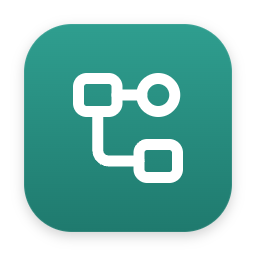
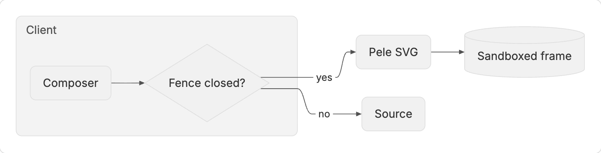
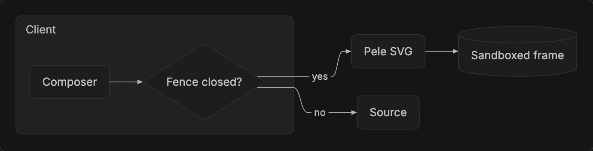
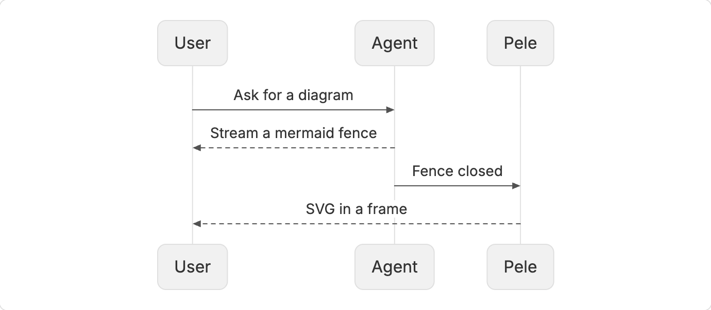
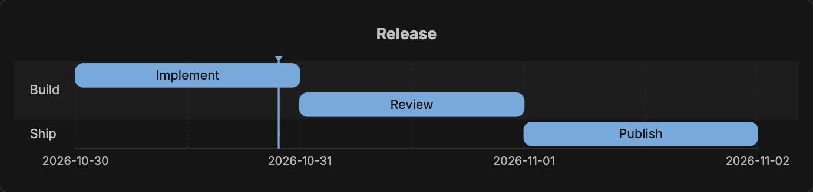
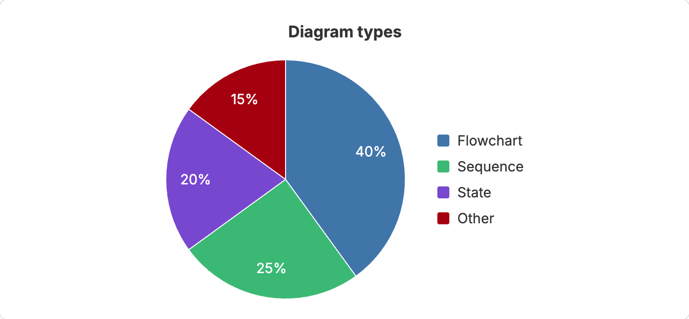
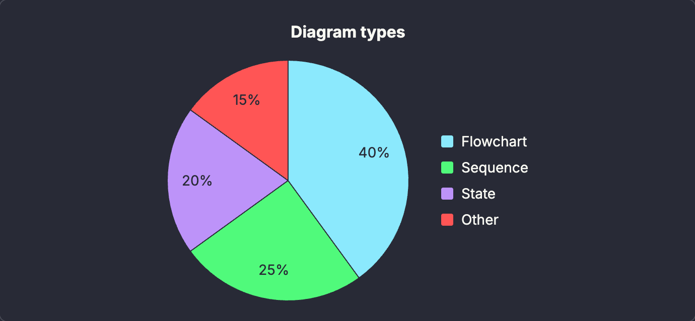

<p align="center">
  
</p>

<h1 align="center">Pele</h1>

<p align="center">
  <strong>Mermaid diagrams in BB, drawn by Pele.</strong>
</p>

<p align="center">
  <a href="#highlights">Highlights</a> ·
  <a href="#screenshots">Screenshots</a> ·
  <a href="#theming">Theming</a> ·
  <a href="#installation">Installation</a> ·
  <a href="#development">Development</a>
</p>

<p align="center">
  
  
</p>

Pele renders the ` ```mermaid ` fences in assistant replies with [Pele](https://pele.run), a fast Mermaid renderer by kepano. Diagrams use BB's colors and fonts and follow light and dark mode.

## Highlights

- 🧭 **Every Mermaid diagram type.** Pele supports all diagram types in Mermaid 12.1, including gitGraph, sankey and mindmap.
- 🎨 **BB's look.** Diagrams take BB's palette, font and corner radius, and recolor when you change the mode or palette.
- 🔍 **Source, copy and zoom.** Each diagram has buttons to show its source, copy the source, and open a large viewer. In the viewer, drag or scroll to pan, and pinch, Ctrl-scroll or the zoom buttons to zoom. Escape closes it.
- ✍️ **Source while streaming.** A fence shows its source while the reply streams and becomes a diagram when the fence closes.
- 🛡️ **Sandboxed output.** Each diagram is SVG in a sandboxed frame. No scripts run in the frame. Diagram links, images and other network loads are blocked. The frame can only load BB's own fonts.
- ↩️ **BB's block as the fallback.** If a fence does not parse, or a reply ends before a fence closes, BB shows its own code block.

## Screenshots

<p align="center">
  
  
</p>

## Theming

Pele has no theme of its own. It reads your BB palette, so diagrams match the rest of BB. Choose a palette in **Settings → Appearance → Palette**, or run `bb theme set <id>`. Theme plugins such as [Vesper](https://github.com/dillionverma/bb-plugin-vesper) work too.

<p align="center">
  
  
</p>

Chart colors come from BB's variables, in this order: `--file-accent`, `--success`, `--pr-merged`, `--destructive`, `--attention`, `--warning`, `--timeline-accent`. Pele skips a color that repeats an earlier one and fills up to eight colors with tints of the first ones.

To set your own colors, write a BB theme. Run `bb theme dir` to find the theme folder, create `<theme folder>/<name>/theme.css` with the variables you want to change, then run `bb theme set <name>`. These variables color the rest of BB too; Pele has no separate diagram settings.

## Installation

```sh
bb plugin install https://github.com/dillionverma/bb-plugin-pele
```

To go back to BB's own Mermaid renderer, run `bb plugin disable pele` and reload BB.

Requires BB 0.47 or later.

## Limitations

- Only assistant replies change. User messages and file previews keep BB's own Mermaid renderer.
- Link and image blocking applies only to diagrams Pele draws. Fallback fences, user messages and file previews use BB's renderer, which can show links and load remote images.
- Inside a Pele diagram, `click` links and image shapes draw as plain shapes.
- Very wide diagrams shrink to fit the column. Open the viewer to read them at full size.

## Development

```sh
git clone https://github.com/dillionverma/bb-plugin-pele.git
cd bb-plugin-pele
npm ci
bb plugin install .
```

Run `npm test`, `npm run typecheck` and `bb plugin build` before submitting changes.

## License

[MIT](LICENSE). Pele is by kepano and is MIT licensed as well; its copyright notice is included in the license.
