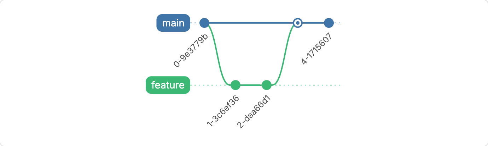
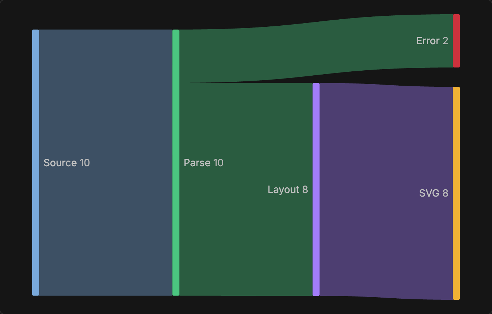
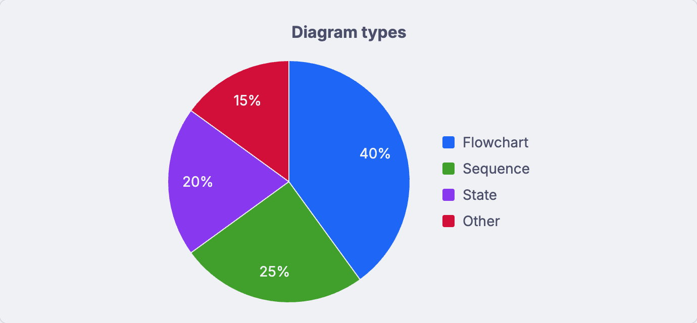
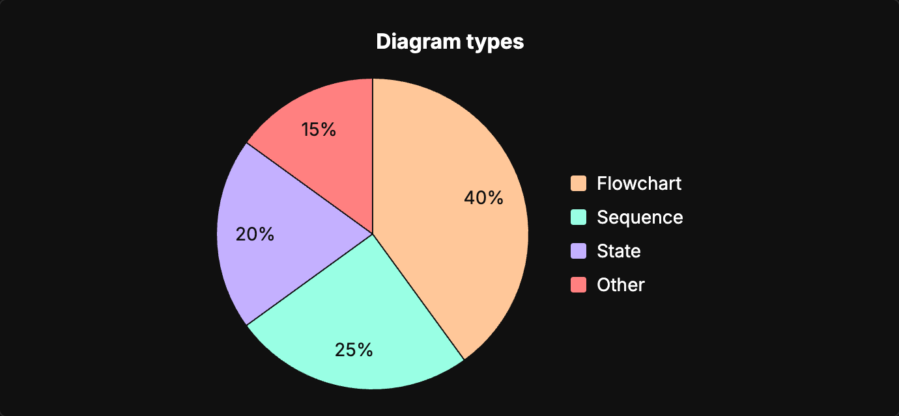

<p align="center">
  
</p>

<h1 align="center">Pele</h1>

<p align="center">
  <strong>Mermaid diagrams in BB, drawn by Pele.</strong>
</p>

<p align="center">
  <a href="#highlights">Highlights</a> ·
  <a href="#screenshots">Screenshots</a> ·
  <a href="#theming">Theming</a> ·
  <a href="#installation">Installation</a> ·
  <a href="#development">Development</a>
</p>

<p align="center">
  
  
</p>

Pele renders the ` ```mermaid ` fences in assistant replies with [Pele](https://pele.run), a fast Mermaid renderer by kepano. Diagrams use BB's colors and fonts and follow light and dark mode.

## Highlights

- 🧭 **Every Mermaid diagram type.** Pele supports all diagram types in Mermaid 12.1, including gitGraph, sankey and mindmap.
- 🎨 **BB's look.** Diagrams take BB's palette, font and corner radius, including chart colors, and recolor when you change the mode or palette.
- ✍️ **Source while streaming.** A fence shows its source while the reply streams and becomes a diagram when the fence closes.
- 🛡️ **Sandboxed output.** Each diagram is SVG in a sandboxed frame. No scripts run in the frame. Diagram links, images and other network loads are blocked. The frame can only load BB's own fonts.
- ↩️ **BB's block as the fallback.** If a fence does not parse, or a reply ends before a fence closes, BB shows its own code block.

## Screenshots

<p align="center">
  
  
</p>

<p align="center">
  
  
</p>

## Theming

Pele has no theme of its own. It reads the colors and fonts of your BB palette, so diagrams match the rest of BB. When you change the palette or switch between light and dark mode, open diagrams recolor at once.

To change how diagrams look, choose a palette in **Settings → Appearance → Palette**, or run `bb theme set <id>`. BB's built-in palettes are `default`, `nord`, `dracula`, `solarized`, `gruvbox` and `catppuccin`. Theme plugins such as [Vesper](https://github.com/dillionverma/bb-plugin-vesper) work too.

<p align="center">
  
  
</p>

<p align="center">
  
  
</p>

<p align="center"><sub>One pie chart in Default, Catppuccin, Dracula and Vesper Dark.</sub></p>

Each part of a diagram takes one BB variable:

| BB variable | Colors in the diagram |
| --- | --- |
| `--background` | The background, and labels on colored fills |
| `--foreground` | Text |
| `--muted-foreground` | Lines, arrows and secondary text |
| `--surface-recessed-solid` | Node fills |
| `--muted` | Secondary fills |
| `--border` | Node borders |
| `--file-accent` | The accent, such as gantt bars, and the first chart color |
| `--success`, `--pr-merged`, `--destructive`, `--attention`, `--warning`, `--timeline-accent` | The next chart colors, in this order |
| `--radius` | Corner radius |
| `--font-sans`, `--font-mono` | Fonts |

Charts use up to eight colors. Pele skips a color that repeats an earlier one. If fewer than eight colors are left, the remaining ones are tints of the first colors.

### Custom colors

To set your own colors, write a BB theme:

1. Run `bb theme dir` to find the theme folder.
2. Create `<theme folder>/my-colors/theme.css`. Set only the variables you want to change.
3. Run `bb theme set my-colors`.

```css
:root,
.light {
  --file-accent: #2563eb;
  --success: #16a34a;
  --pr-merged: #9333ea;
  --destructive: #dc2626;
}

.dark {
  --file-accent: #60a5fa;
  --success: #4ade80;
  --pr-merged: #c084fc;
  --destructive: #f87171;
}
```

These variables color the rest of BB too. Pele has no separate diagram settings.

## Installation

```sh
bb plugin install https://github.com/dillionverma/bb-plugin-pele
```

To go back to BB's own Mermaid renderer, run `bb plugin disable pele` and reload BB.

Requires BB 0.47 or later.

## Limitations

- Only assistant replies change. User messages and file previews keep BB's own Mermaid renderer.
- Pele draws `click` links and image shapes as plain shapes. Fences that fall back to BB's block, and fences in user messages and file previews, use BB's renderer, which can show links and load remote images.
- Pele diagrams do not have BB's show-source, copy and zoom controls. Version 0.1 has no pan or zoom.
- Very wide diagrams shrink to fit the column, so their text can become very small.

## Development

```sh
git clone https://github.com/dillionverma/bb-plugin-pele.git
cd bb-plugin-pele
npm ci
bb plugin install .
```

Run `npm test`, `npm run typecheck` and `bb plugin build` before submitting changes.

## License

[MIT](LICENSE). Pele is by kepano and is MIT licensed as well; its copyright notice is included in the license.
